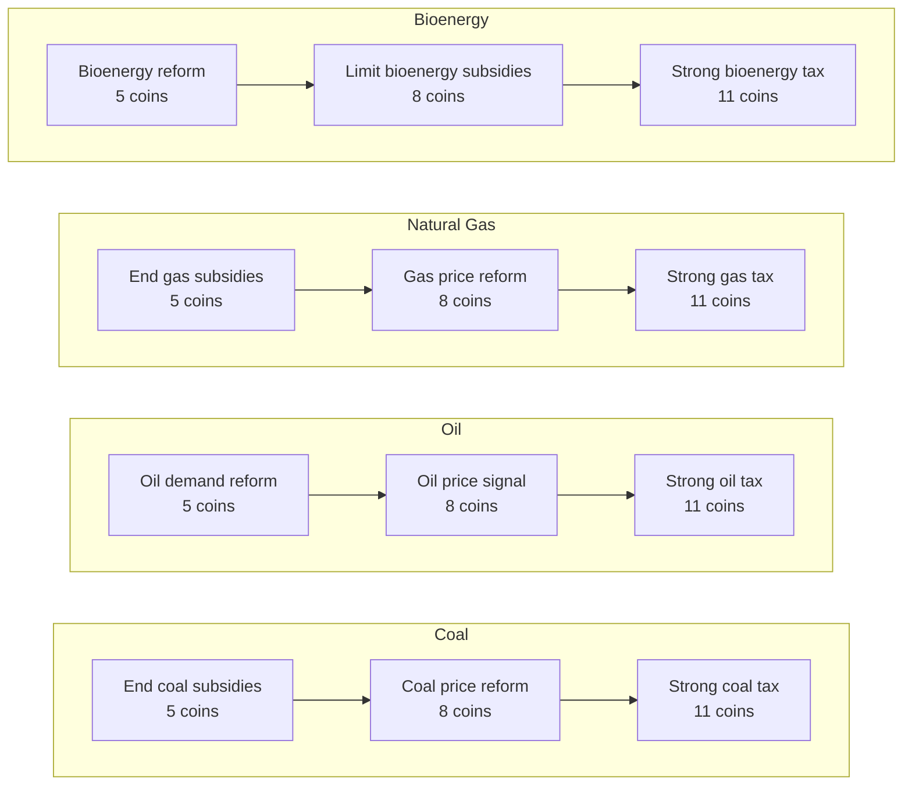
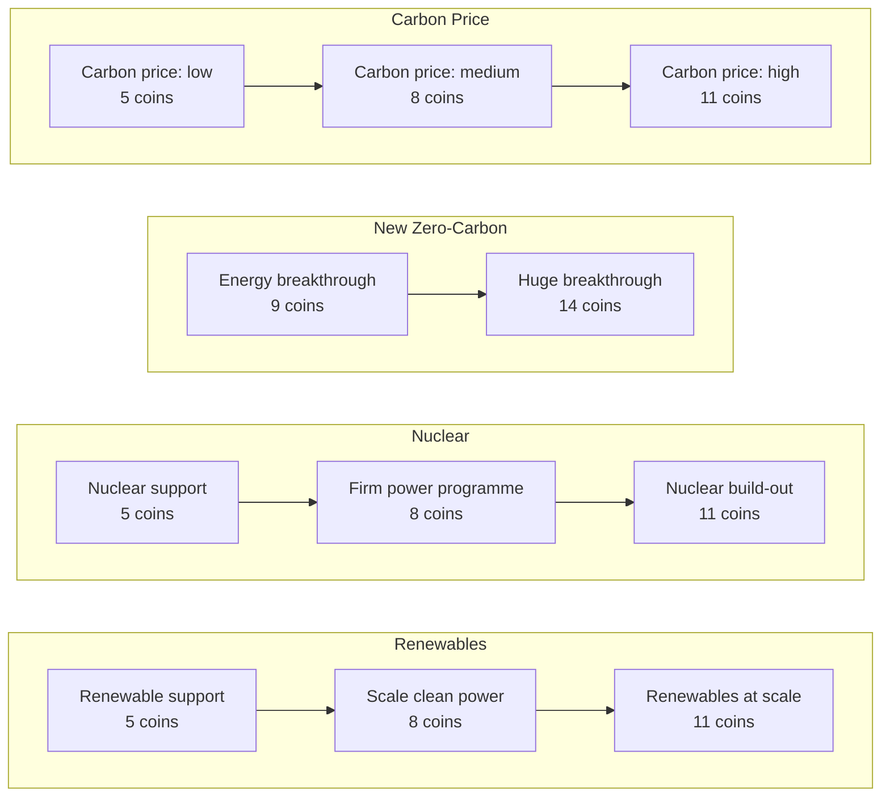
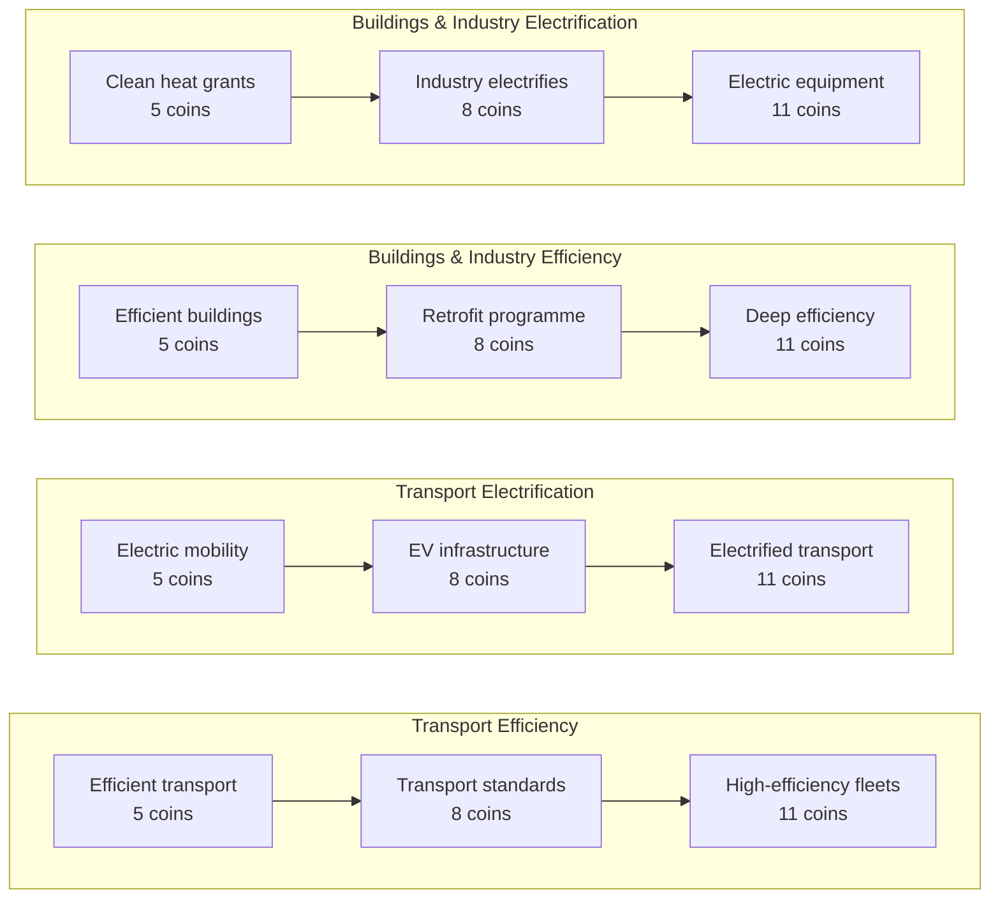
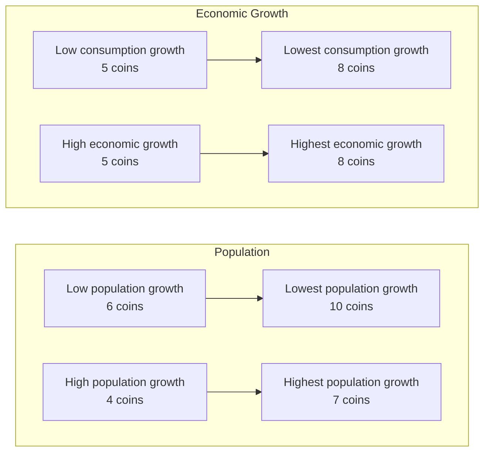
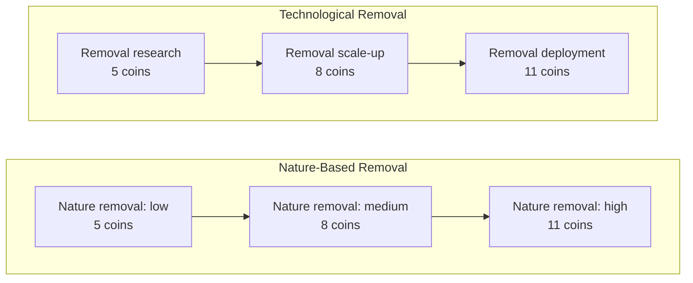
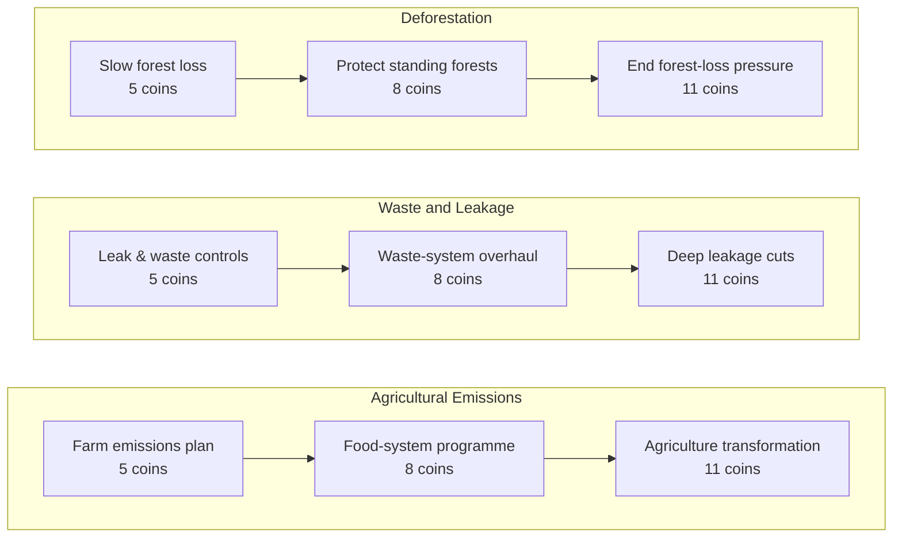
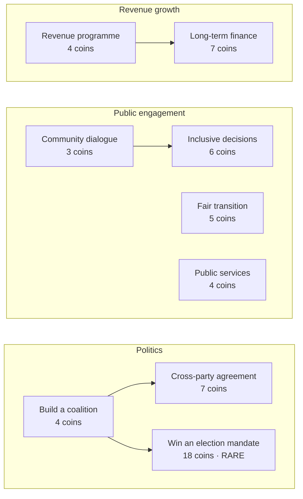
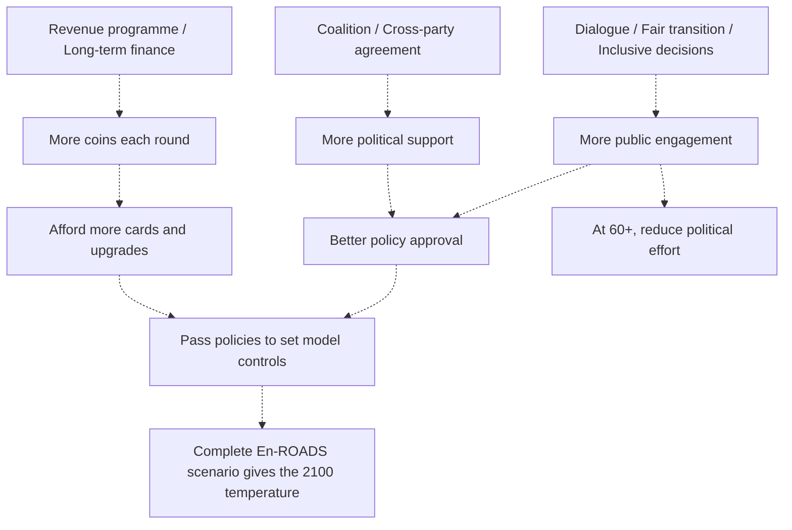

# APECS card guide

Current game **0.10** · **67 cards** · En-ROADS **26.10.0** · Updated 5 November 2026.

Each box is a card. An arrow means **the first card must pass before the next card can appear**. Cards without an incoming arrow have no card prerequisite. Unlocking makes a card eligible for a later random hand.

The price shown is the cost of that card alone. Upgrading requires paying for each stage along the way. For example, a 5 → 8 → 11 path costs 24 coins in total.

## Contents

- [Energy — fuels and pricing](#section-1)
- [Energy — clean power and carbon price](#section-2)
- [Demand — efficiency and electrification](#section-3)
- [Growth — population and economic scenarios](#section-4)
- [Removal](#section-5)
- [Land and gases](#section-6)
- [Support cards](#support-cards)
- [How the paths interact](#how-the-paths-interact)

## Reading the effects

- **Revenue** means the game resource called Revenue growth.
- **Politics** means political support, which has the strongest effect on approval.
- **Engagement** means public engagement, which gives a smaller approval boost.
- A pair such as **Politics −10 / −8** means **below 60 engagement / at least 60 engagement**. These are the full effects of an accepted card, including its political effort.
- The eight ordinary support cards have a 100% approval rate. Policy cards and the election wildcard use the current game state to calculate their approval.
- Ordinary rejected cards refund half their cost, rounded down, and lose 4 politics. The election wildcard has its own rejection rule below.

Targets in the tables are absolute En-ROADS settings. A later accepted card for the same control replaces the previous setting. Temperature is calculated from the complete 19-control package.

## Energy — fuels and pricing

### Coal

| Card | Coins | Model target | Buffs and debuffs when passed |
| --- | ---: | --- | --- |
| End coal subsidies | 5 | 0% net tax | Politics −10 / −8 |
| Coal price reform | 8 | 75% net tax | Politics −14 / −12 |
| Strong coal tax | 11 | 160% net tax | Politics −18 / −16 |

### Oil

| Card | Coins | Model target | Buffs and debuffs when passed |
| --- | ---: | --- | --- |
| Oil demand reform | 5 | 50% net tax | Politics −10 / −8 |
| Oil price signal | 8 | 100% net tax | Politics −14 / −12 |
| Strong oil tax | 11 | 180% net tax | Politics −18 / −16 |

### Natural Gas

| Card | Coins | Model target | Buffs and debuffs when passed |
| --- | ---: | --- | --- |
| End gas subsidies | 5 | 0% net tax | Politics −10 / −8 |
| Gas price reform | 8 | 75% net tax | Politics −14 / −12 |
| Strong gas tax | 11 | 160% net tax | Politics −18 / −16 |

### Bioenergy

| Card | Coins | Model target | Buffs and debuffs when passed |
| --- | ---: | --- | --- |
| Bioenergy reform | 5 | 0% net tax | Politics −10 / −8 |
| Limit bioenergy subsidies | 8 | 70% net tax | Politics −14 / −12 |
| Strong bioenergy tax | 11 | 150% net tax | Politics −18 / −16 |

## Energy — clean power and carbon price

### Renewables

| Card | Coins | Model target | Buffs and debuffs when passed |
| --- | ---: | --- | --- |
| Renewable support | 5 | 40% subsidy | Politics −10 / −8 |
| Scale clean power | 8 | 65% subsidy | Politics −14 / −12 |
| Renewables at scale | 11 | 90% subsidy | Politics −18 / −16 |

### Nuclear

| Card | Coins | Model target | Buffs and debuffs when passed |
| --- | ---: | --- | --- |
| Nuclear support | 5 | 45% subsidy | Politics −10 / −8 |
| Firm power programme | 8 | 70% subsidy | Politics −14 / −12 |
| Nuclear build-out | 11 | 95% subsidy | Politics −18 / −16 |

### New Zero-Carbon

| Card | Coins | Model target | Buffs and debuffs when passed |
| --- | ---: | --- | --- |
| Energy breakthrough | 9 | Breakthrough | Politics −10 / −8 |
| Huge breakthrough | 14 | Huge breakthrough | Politics −14 / −12 |

### Carbon Price

| Card | Coins | Model target | Buffs and debuffs when passed |
| --- | ---: | --- | --- |
| Carbon price: low | 5 | $20/t CO₂ | Politics −10 / −8 |
| Carbon price: medium | 8 | $60/t CO₂ | Politics −14 / −12 |
| Carbon price: high | 11 | $100/t CO₂ | Politics −18 / −16 |

## Demand — efficiency and electrification

### Transport Efficiency

| Card | Coins | Model target | Buffs and debuffs when passed |
| --- | ---: | --- | --- |
| Efficient transport | 5 | 1.5%/year efficiency | Politics −10 / −8 |
| Transport standards | 8 | 2.2%/year efficiency | Politics −14 / −12 |
| High-efficiency fleets | 11 | 3%/year efficiency | Politics −18 / −16 |

### Transport Electrification

| Card | Coins | Model target | Buffs and debuffs when passed |
| --- | ---: | --- | --- |
| Electric mobility | 5 | 20% purchase subsidy | Politics −10 / −8 |
| EV infrastructure | 8 | 35% purchase subsidy | Politics −14 / −12 |
| Electrified transport | 11 | 50% purchase subsidy | Politics −18 / −16 |

### Buildings & Industry Efficiency

| Card | Coins | Model target | Buffs and debuffs when passed |
| --- | ---: | --- | --- |
| Efficient buildings | 5 | 1.8%/year efficiency | Politics −10 / −8 |
| Retrofit programme | 8 | 2.4%/year efficiency | Politics −14 / −12 |
| Deep efficiency | 11 | 3%/year efficiency | Politics −18 / −16 |

### Buildings & Industry Electrification

| Card | Coins | Model target | Buffs and debuffs when passed |
| --- | ---: | --- | --- |
| Clean heat grants | 5 | 15% purchase subsidy | Politics −10 / −8 |
| Industry electrifies | 8 | 30% purchase subsidy | Politics −14 / −12 |
| Electric equipment | 11 | 50% purchase subsidy | Politics −18 / −16 |

## Growth — population and economic scenarios

### Population

| Card | Coins | Model target | Buffs and debuffs when passed |
| --- | ---: | --- | --- |
| Low population growth | 6 | 9.7bn in 2100 | Politics −9 / −7; Engagement +4 |
| Lowest population growth | 10 | 9.1bn in 2100 | Politics −11 / −9; Engagement +4 |
| High population growth | 4 | 10.8bn in 2100 | Politics −9 / −7 |
| Highest population growth | 7 | 11.3bn in 2100 | Politics −11 / −9 |

### Economic Growth

| Card | Coins | Model target | Buffs and debuffs when passed |
| --- | ---: | --- | --- |
| Low consumption growth | 5 | 1% GDP/person growth | Revenue −9; Politics −14 / −12 |
| Lowest consumption growth | 8 | 0.5% GDP/person growth | Revenue −9; Politics −16 / −14 |
| High economic growth | 5 | 2% GDP/person growth | Revenue +9; Politics −3 / −1 |
| Highest economic growth | 8 | 2.5% GDP/person growth | Revenue +9; Politics −5 / −3 |

Population and GDP cards explore scenario assumptions. Low and high are separate branches. A stage-two card also requires its own stage-one target to be the currently active setting. A stage-one card can switch the active branch. After switching, the earlier branch's upgrade stays locked while its first-stage setting is inactive. Already adopted stage-one cards cannot be replayed.

## Removal

### Nature-Based Removal

| Card | Coins | Model target | Buffs and debuffs when passed |
| --- | ---: | --- | --- |
| Nature removal: low | 5 | 25% of potential | Politics −10 / −8 |
| Nature removal: medium | 8 | 55% of potential | Politics −14 / −12 |
| Nature removal: high | 11 | 85% of potential | Politics −18 / −16 |

### Technological Removal

| Card | Coins | Model target | Buffs and debuffs when passed |
| --- | ---: | --- | --- |
| Removal research | 5 | 25% of potential | Politics −10 / −8 |
| Removal scale-up | 8 | 55% of potential | Politics −14 / −12 |
| Removal deployment | 11 | 85% of potential | Politics −18 / −16 |

## Land and gases

### Agricultural Emissions

| Card | Coins | Model target | Buffs and debuffs when passed |
| --- | ---: | --- | --- |
| Farm emissions plan | 5 | 30% of potential | Politics −10 / −8 |
| Food-system programme | 8 | 60% of potential | Politics −14 / −12 |
| Agriculture transformation | 11 | 90% of potential | Politics −18 / −16 |

### Waste and Leakage

| Card | Coins | Model target | Buffs and debuffs when passed |
| --- | ---: | --- | --- |
| Leak & waste controls | 5 | 30% of potential | Politics −10 / −8 |
| Waste-system overhaul | 8 | 60% of potential | Politics −14 / −12 |
| Deep leakage cuts | 11 | 90% of potential | Politics −18 / −16 |

### Deforestation

| Card | Coins | Model target | Buffs and debuffs when passed |
| --- | ---: | --- | --- |
| Slow forest loss | 5 | -2%/year forest-loss trend | Politics −10 / −8 |
| Protect standing forests | 8 | -5%/year forest-loss trend | Politics −14 / −12 |
| End forest-loss pressure | 11 | -9%/year forest-loss trend | Politics −18 / −16 |

## Support cards

| Card | Coins | Buffs when passed | Repeatable? |
| --- | ---: | --- | --- |
| Build a coalition | 4 | Politics +20 | Yes |
| Cross-party agreement | 7 | Politics +30; Engagement +4 | No |
| Community dialogue | 3 | Politics +6; Engagement +18 | Yes |
| Fair transition | 5 | Politics +12; Engagement +16 | Yes |
| Inclusive decisions | 6 | Politics +10; Engagement +24 | No |
| Revenue programme | 4 | Revenue +18 | Yes |
| Long-term finance | 7 | Revenue +26; Politics −4 | No |
| Public services | 4 | Revenue +5; Engagement +12 | Yes |
| Win an election mandate | 18 | Politics +20; election mandate | No |

**Win an election mandate** branches directly from **Build a coalition**. It can pass without Cross-party agreement. It costs 18 coins and appears as a rare offer. Passing raises later ordinary policy approval to 96–99%. Rejection refunds 4 coins and loses 15 politics.

## How the paths interact

The solid arrows in the card diagrams are the actual unlock requirements. The dashed arrows below show resource benefits.

Revenue funds all pathways. Politics and public engagement improve the chance of passing them. Support cards affect these game resources. Their climate effect comes through the model policies they help the player adopt.

The main model paths have no cross-path card prerequisites. For example, Electric mobility can be offered before Renewable support. Their combined climate effects are handled by En-ROADS.

## Costs and game limits

- Start with **8 coins** and hold at most **20**.
- Income follows **3 + floor(Revenue / 25)** coins per round. Revenue ranges from 0 to 100, giving **3–7 coins per round** under the current rules. The starting value gives **5**. Available bank space limits what can be collected.
- Play up to **three offered cards** together when the combined cost is affordable. Each receives its own verdict.
- Prerequisites must have passed in an earlier round. A parent and its upgrade cannot be unlocked together in one package.
- Shuffle costs **1, then 2, then 3… coins** within the same round. Settling the round resets the price.
- Skip carries saved coins into the next round and receives the usual round income. The final round ends the game.
- Arcade rounds **4 and 7** award up to **5 extra coins** each, limited by remaining bank space.

All costs, resource effects, approval rules and card-to-control target choices are game design assumptions. Population and GDP are model scenario assumptions. Whole-scenario En-ROADS evaluation supplies the final temperature.

Source of card names, costs, targets and links: [policy catalogue](../src/game/policy-catalogue.ts). Resource effects and eligibility: [policy rules](../src/game/v9.ts). Current arcade rewards: [0.10 rules](../src/game/v10.ts).
