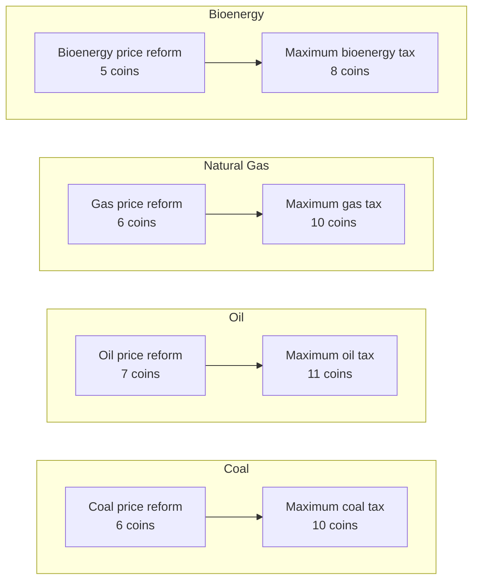
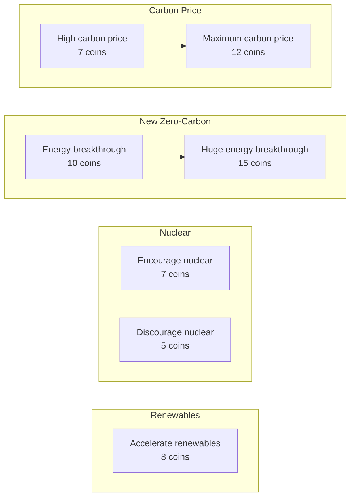
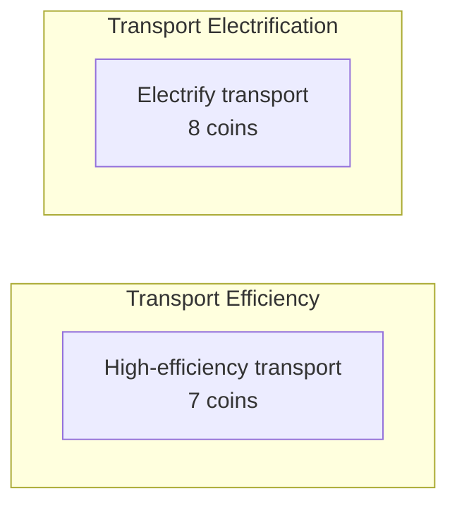
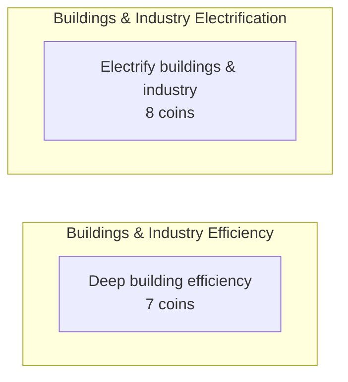
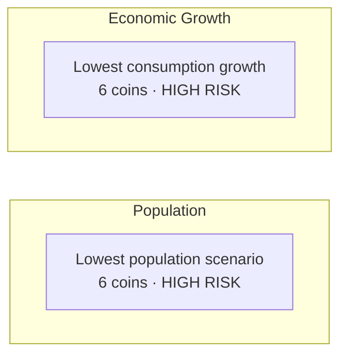
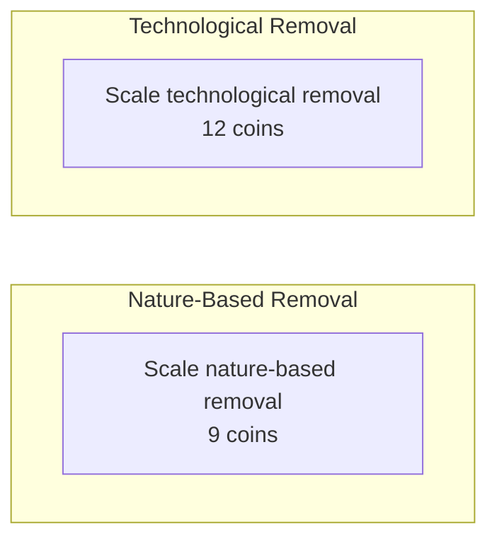
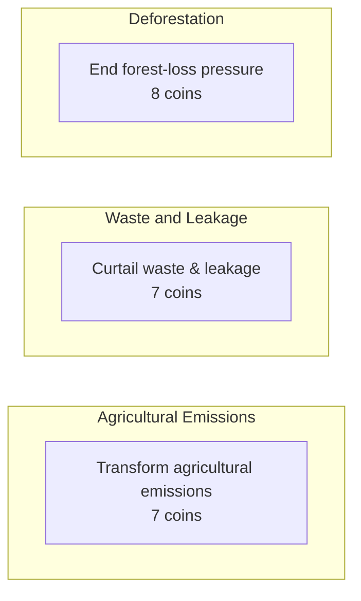
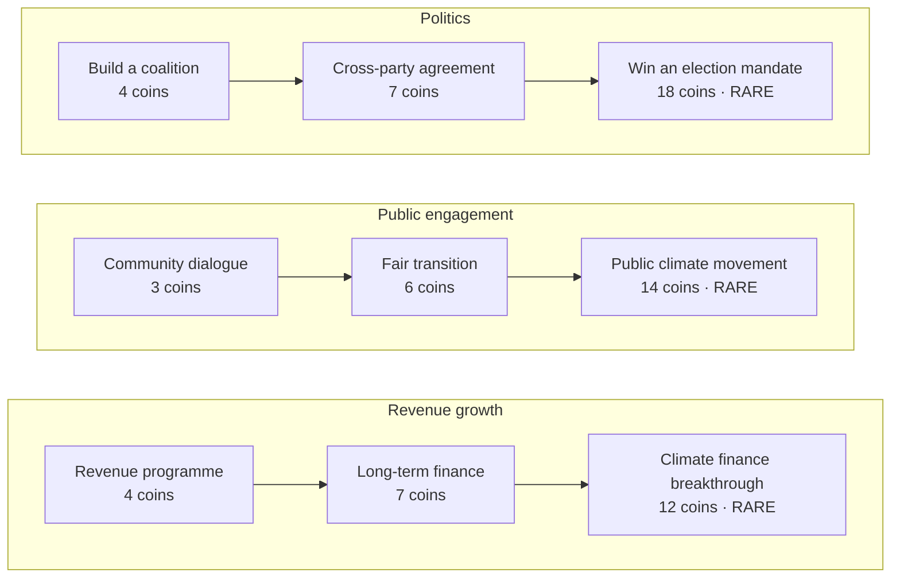
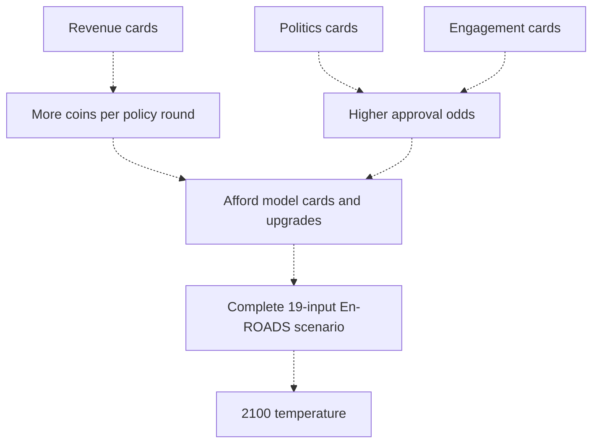

# APECS card guide — 35-card version

Current rules **0.13** · **26 model cards + 9 support cards** · En-ROADS **26.11.0**.

Updated 8 November 2026.

## Read the map

Each box is one card and its price. **An arrow means the earlier card must pass before the next one becomes eligible.** An eligible card can appear in a random hand.

- Model cards with two stages use a midpoint target and an endpoint target.
- First-stage targets are halfway from the status quo to the chosen slider end, rounded to a reachable one-unit step for taxes/prices.
- Upgrades require both the first card and **stage 2 or 3** of the game.
- Nuclear's two cards are alternatives. **Passing either permanently locks the other out for that game.**
- Red cards are high-risk growth scenarios. Gold cards are the final upgrades in their support paths.

## Round structure

```text
Stage 1: 1 → 2 → 3 → 4 → ★ Flight
Stage 2: 5 → 6 → 7 → 8 → ★ Reef
Stage 3: 9 → 10 → 11 → 12 → Result
```

There are **twelve policy rounds and two arcade breaks**. The stars mark the breaks after rounds 4 and 8. Every policy is adopted in 2026, and the final complete model scenario gives the 2100 temperature.

Hands contain up to one support card. The preferred path rotates from revenue to politics to public engagement. Each path offers its next unadopted upgrade. Each shuffle costs more within a round. First-stage model cards can appear throughout the game.

## Effects key

**Revenue** is the revenue growth resource. **Politics** is political support, and **Engagement** is public support. The arrows on offered cards show which resources change if adopted. A dash indicates that the card leaves those resources alone. Approval depends on support, engagement and card difficulty. Costs and resource effects are game assumptions.

## Energy supply





| Card | Coins | Absolute model target | Buffs and debuffs when passed |
| --- | ---: | --- | --- |
| Coal price reform | 6 | 85% net tax | — |
| Maximum coal tax | 10 | 200% net tax | Politics −7 |
| Oil price reform | 7 | 108% net tax | — |
| Maximum oil tax | 11 | 200% net tax | Politics −7 |
| Gas price reform | 6 | 85% net tax | — |
| Maximum gas tax | 10 | 200% net tax | Politics −7 |
| Bioenergy price reform | 5 | 93% net tax | — |
| Maximum bioenergy tax | 8 | 200% net tax | Engagement −6 |
| Accelerate renewables | 8 | 100% subsidy | Revenue +3 |
| Encourage nuclear | 7 | 100% subsidy | Politics −8 |
| Discourage nuclear | 5 | 50% net tax | Revenue −4, Politics +5 |
| Energy breakthrough | 10 | Breakthrough | — |
| Huge energy breakthrough | 15 | Huge breakthrough | — |
| High carbon price | 7 | $128/t CO₂ | — |
| Maximum carbon price | 12 | $250/t CO₂ | Politics −7 |

**Nuclear is a choose-one branch.** Encourage nuclear sets a 100% net subsidy. Discourage nuclear sets a 50% net tax. The game locks the opposite card after either passes. A tax/subsidy endpoint changes competitiveness within the model and does not guarantee zero use of a fuel.

## Transport



| Card | Coins | Absolute model target | Buffs and debuffs when passed |
| --- | ---: | --- | --- |
| High-efficiency transport | 7 | 3%/year efficiency | — |
| Electrify transport | 8 | 50% purchase subsidy | — |

## Buildings and industry



| Card | Coins | Absolute model target | Buffs and debuffs when passed |
| --- | ---: | --- | --- |
| Deep building efficiency | 7 | 3%/year efficiency | — |
| Electrify buildings & industry | 8 | 50% purchase subsidy | — |

## Growth — high-risk scenarios



| Card | Coins | Absolute model target | Buffs and debuffs when passed |
| --- | ---: | --- | --- |
| Lowest population scenario | 6 | 9bn in 2100 | Politics −35, Engagement −45 |
| Lowest consumption growth | 6 | 0.5% GDP/person growth | Revenue −40, Politics −30 |

The population card explores **9 billion people in 2100**. Its historical Chinese population-policy photograph illustrates rights and public-trust risks. En-ROADS treats population as a scenario assumption and does not establish a guaranteed numerical effect for a one-child policy. Both growth cards sharply damage the game resources shown above.

## Carbon dioxide removal



| Card | Coins | Absolute model target | Buffs and debuffs when passed |
| --- | ---: | --- | --- |
| Scale nature-based removal | 9 | 100% of potential | — |
| Scale technological removal | 12 | 100% of potential | — |

## Other greenhouse gases and deforestation



| Card | Coins | Absolute model target | Buffs and debuffs when passed |
| --- | ---: | --- | --- |
| Transform agricultural emissions | 7 | 100% of potential | — |
| Curtail waste & leakage | 7 | 100% of potential | — |
| End forest-loss pressure | 8 | -10%/year forest-loss trend | — |

## Support cards — three paths



| Card | Coins | Effect when adopted |
| --- | ---: | --- |
| Revenue programme | 4 | Revenue +25 and income of at least 5 coins per round |
| Long-term finance | 7 | Revenue +25 and income of at least 6 coins per round |
| Climate finance breakthrough | 12 | Revenue rises to its cap and income reaches 8 coins per round |
| Community dialogue | 3 | Politics +5, Engagement +18 |
| Fair transition | 6 | Politics +12, Engagement +24 |
| Public climate movement | 14 | Politics +20, Engagement +60 |
| Build a coalition | 4 | Politics +20 |
| Cross-party agreement | 7 | Politics +30, Engagement +4 |
| Win an election mandate | 18 | Politics +25 and 96–99% approval on later ordinary policies |

Adopt each upgrade once. All three revenue upgrades and the first two cards of the other paths pass automatically. Public climate movement and Win an election mandate have approval checks. Their rejection refunds 25% of the price, rounded down. Ordinary policy rejection refunds 50%, rounded down. Support changes come from adopted cards with an explicit effect.

## Survival breaks

- Flappy Flight follows policy round 4. Reef Rescue follows policy round 8.
- Each game continues until collision ends the run. The timer counts up.
- Speed and obstacle pressure increase as the run continues.
- Earn **1 coin per 4 seconds survived, up to 8 coins per break**, subject to bank space.
- Survival inputs are replayed by the server before coins are awarded.

## What connects to what?



Dotted lines show resource relationships. Solid arrows in the card maps show actual card prerequisites. The 26 model cards set the model inputs. Support cards help fund or pass those cards.

## Can every result be saved in advance?

The unrestricted setting space has **8,957,952 combinations**. Seven controls have three possible states including the status quo, and the other twelve have two states. That is **3⁷ × 2¹²**. Costs, stage gates and round limits reduce the combinations a real player can reach.

The game saves complete, verified scenarios and reuses an exact matching result. New combinations go through the simulator once. Adding separate cards' temperature changes together would miss interactions between controls.

## Current budget rules

Start with **8 coins** and hold up to **20**. Income after a policy round is **4 + floor(Revenue / 25)**, giving 4–8 coins. Revenue starts at 20 points, so the starting rate is 4 coins. Stars award their survival bonus separately. The final policy round ends the game.

Play up to three offered cards if their combined price is affordable. A support card in the same package cannot fund other cards in that package. All cards receive their quoted approval check before any buffs are applied. A parent policy and its upgrade require separate rounds.

Shuffle costs 1, then 2, then 3… coins within a round, and resets when the round settles. Skip carries the saved coins forward and receives ordinary policy-round income.

The design choices in this file describe the current game. Scientific projections come from the complete version-pinned En-ROADS evaluation. Population and GDP targets are scenario assumptions.

Sources in the repository: [current catalogue](../src/game/v11-catalogue.ts), [current rules](../src/game/v11.ts), [round schedule](../src/game/v11-schedule.ts), [survival physics](../src/game/arcade.ts).
